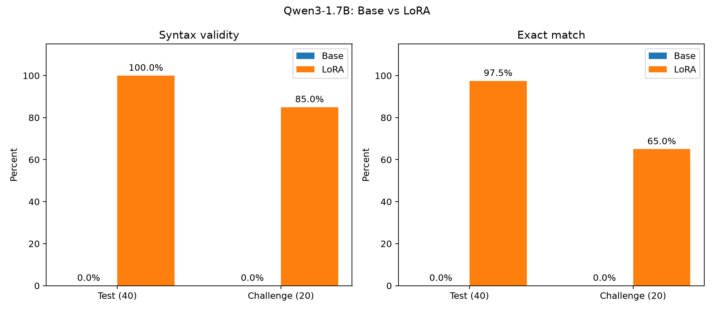
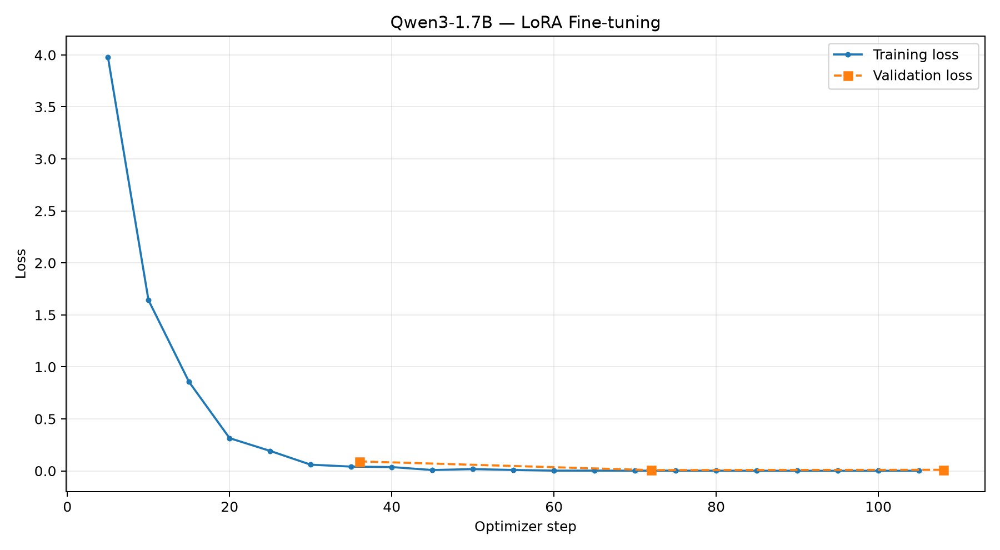

# ECQL Query Generator — Fine-tuning Qwen3-1.7B с помощью LoRA

**Эксперимент по обучению небольшой языковой модели переводу естественных запросов на русский язык корпоративного DSL ECQL.**

Цель исследования — проверить, можно ли с помощью небольшого синтетического датасета и параметрически эффективного дообучения (LoRA) научить Qwen3-1.7B генерировать запросы на ранее неизвестном ей специализированном языке.

В проекте реализован полный цикл эксперимента: спецификация DSL, генерация датасета, валидация запросов, оценка базовой модели, Fine-tuning, повторная оценка и анализ ошибок.

**Главный результат:** Exact Match вырос с **0% до 97,5%** на тестовой выборке и с **0% до 65%** на отдельном наборе запросов с более естественными формулировками.

## 1. Постановка задачи

Большие языковые модели знакомы с SQL, но могут не знать специализированные языки запросов, используемые во внутренних системах компаний.

В рамках эксперимента разработан учебный DSL — **ECQL (E-Corp Query Language)**.

Задача модели — переводить запросы пользователей на русском языке в корректные выражения ECQL.

**Пример пользовательского запроса:**

> Найди сотрудников из Москвы с зарплатой выше 150000.

**Ожидаемый результат:**

```
FETCH [EMPLOYEES] WHERE @city IS 'Moscow' && @salary ABOVE 150000
```

До обучения Qwen3-1.7B преимущественно использовала привычный ей синтаксис SQL.

Пример зафиксированного ответа базовой модели:

```sql
SELECT * FROM employees WHERE city = 'Москва' AND salary > 150000;
```

Смысл запроса распознан, но синтаксис не соответствует ECQL.

**Гипотеза:** небольшого количества качественных пар «естественный запрос → ECQL» достаточно, чтобы с помощью LoRA научить модель структуре нового DSL без полного переобучения всех параметров.

## 2. Спецификация ECQL

ECQL v1.0 — ограниченный учебный язык запросов.

Поддерживаются четыре сущности:

| Сущность | Назначение |
|---|---|
| `EMPLOYEES` | Сотрудники |
| `PROJECTS` | Проекты |
| `INVENTORY` | Товары и складские остатки |
| `DEALS` | Сделки |

Операторы сравнения:

| Оператор | Значение |
|---|---|
| `IS` | Равно |
| `NOT` | Не равно |
| `ABOVE` | Строго больше |
| `BELOW` | Строго меньше |

Также поддерживаются логические связки `&&` (И) и `||` (ИЛИ) и форматы вывода `AS JSON`, `AS TABLE`, `AS LIST`.

Пример:

```
FETCH [PROJECTS] WHERE @status IS 'active' && @budget ABOVE 500000 AS TABLE
```

ECQL не поддерживает SQL-конструкции `SELECT`, `JOIN`, `GROUP BY`, сортировку, агрегации, вложенные условия и смешанные логические связки.

Полная спецификация, допустимые поля и типы данных представлены в [docs/ecql_spec.md](docs/ecql_spec.md).

Для проверки корректности выражений разработан собственный парсер и валидатор — `src/ecql_query_generator/validator.py`.

## 3. Подготовка датасета

Датасет создавался программно с фиксированным значением `seed=42`.

**Основной корпус — 200 примеров:**

- 160 примеров Train.
- 40 примеров Test.

Дополнительно подготовлен **Challenge Set из 20 запросов** с более естественными формулировками.

Из 160 тренировочных примеров для обучения использовались 144, остальные 16 выделены для валидации.

Каждая запись содержит три поля:

```json
{
  "instruction": "Переведи запрос на ECQL",
  "input": "Кто получает больше 150 тысяч?",
  "output": "FETCH [EMPLOYEES] WHERE @salary ABOVE 150000"
}
```

*Пример выше иллюстрирует формат записи на основе одного из запросов Challenge Set.*

### Принцип генерации

Датасет строился от эталонного выражения к естественному языку.

Сначала генератор создавал валидную структуру ECQL, затем формировал соответствующее русскоязычное описание.

Это позволило автоматически контролировать корректность целевых запросов.

При генерации использовались:

- Разные сущности и поля.
- Строковые и числовые условия.
- Операторы сравнения.
- Логические связки.
- Несколько условий в одном запросе.
- Различные форматы вывода.
- Запросы без фильтрации.

Тестовая выборка использует отдельные семейства языковых шаблонов, отсутствующие в Train.

При подготовке корпуса проверялись синтаксис всех эталонных запросов и отсутствие дубликатов.

**Ограничение:** основная выборка синтетическая. Отсутствие одинаковых примеров не означает отсутствия сходных шаблонов или гарантированной способности модели обобщать на произвольные запросы.

## 4. Модель и конфигурация обучения

**Базовая модель:** `Qwen/Qwen3-1.7B`.

**Метод:** Supervised Fine-Tuning (SFT) с использованием LoRA.

Обучение реализовано с помощью PyTorch, Hugging Face Transformers, PEFT и TRL `SFTTrainer`.

| Параметр | Значение |
|---|---|
| Базовая модель | Qwen3-1.7B |
| Метод | LoRA / SFT |
| Количество обучаемых параметров | 3 211 264 |
| Доля обучаемых параметров | 0,1863% |
| LoRA rank | 8 |
| LoRA alpha | 16 |
| LoRA dropout | 0,05 |
| Target modules | `q_proj`, `k_proj`, `v_proj`, `o_proj` |
| Тип весов базовой модели | BF16 |
| Epochs | 3 |
| Learning rate | 2e-4 |
| Batch size | 1 |
| Gradient accumulation | 4 |
| Max sequence length | 256 |
| Шаги оптимизатора | 108 |
| Random seed | 42 |

Исходные веса модели оставались замороженными. Обновлялись только параметры LoRA-адаптеров.

Функция потерь рассчитывалась по целевому ECQL-ответу, а не по тексту пользовательского запроса.

Для генерации использовался Qwen3 Chat Template с отключённым режимом рассуждений (`enable_thinking=False`).

## 5. Обучение на CPU

Один из практических вопросов исследования — возможно ли дообучить модель такого размера без GPU.

Эксперимент выполнялся на виртуальной машине Yandex Cloud:

| Ресурс | Конфигурация |
|---|---|
| CPU | AMD EPYC Genoa |
| vCPU | 16 |
| RAM | Около 62 GiB |
| OS | Ubuntu 24.04 |
| GPU | Отсутствует |
| Precision | BF16 |

Перед обучением был выполнен отдельный CPU-бенчмарк с реальным forward/backward pass.

Он подтвердил возможность обновления параметров LoRA на CPU.

**Результат полного обучения:**

- 3 эпохи.
- 108 шагов оптимизатора.
- 144 тренировочных примера.
- Время: **589,63 секунды (9 минут 50 секунд)**.
- Размер итогового LoRA-адаптера: около **13 МБ**.

Таким образом, для небольшого DSL-эксперимента оказалось достаточно CPU-инфраструктуры.

Это не означает, что CPU всегда выгоднее GPU: результат зависит от архитектуры модели, размера корпуса и длины последовательностей.

## 6. Методика оценки качества

До и после обучения модель проверялась на одинаковых тестовых данных:

- **Test Set:** 40 примеров.
- **Challenge Set:** 20 примеров.

Оба набора не использовались для оптимизации параметров.

Генерация выполнялась детерминированно (`do_sample=False`), с ограничением `max_new_tokens=128`.

Для сравнения использовались три метрики.

**Syntax Validity** — доля ответов, которые проходят ECQL-валидатор.

**Exact Match Accuracy** — доля ответов, полностью совпадающих с эталоном после нормализации пробелов.

**SQL Hallucination Rate** — доля ответов с SQL-маркерами, например `SELECT`, `FROM`, `JOIN`, `LIMIT`.

Последняя метрика является диагностической эвристикой, а не универсальным измерением галлюцинаций.

Training Loss и Validation Loss анализировались отдельно и не подменяли оценку итогового качества генерации.

## 7. Результаты Fine-tuning

### Сравнение Base vs LoRA

| Метрика | Base Test | LoRA Test | Base Challenge | LoRA Challenge |
|---|---:|---:|---:|---:|
| Syntax Validity | 0% | **100%** | 0% | **85%** |
| Exact Match | 0% | **97,5%** | 0% | **65%** |
| SQL Hallucination Rate | 95% | **0%** | 50% | **0%** |

После обучения модель выдала:

- **39 из 40** точных ответов на Test.
- **13 из 20** точных ответов на Challenge.



### Динамика обучения

По итогам трёх эпох:

| Метрика | Значение |
|---|---:|
| Общий Training Loss | 0,33195 |
| Финальный Validation Loss | 0,01036 |
| Validation Mean Token Accuracy | 99,82% |



К концу обучения Training Loss на отдельных логируемых интервалах снизился примерно до 0,001.

При этом почти идеальная точность токенов на Validation не означает почти идеальную точность готовых ECQL-запросов.

Для оценки обобщающей способности важнее результаты отдельного Challenge Set.

## 8. Анализ ошибок

После Fine-tuning осталось восемь несовпадений:

- Одно на Test.
- Семь на Challenge.

### Случай 1. Альтернативное выражение условия

Пользовательский запрос:

> Подбери сотрудников по критериям: город не равен значению «Казань» и одновременно стаж строго меньше 3 и одновременно статус — «неактивный»; результат в формате JSON.

Ожидаемый запрос:

```
FETCH [EMPLOYEES] WHERE @city NOT 'Kazan' && @experience BELOW 3 && @status IS 'inactive' AS JSON
```

Ответ модели:

```
FETCH [EMPLOYEES] WHERE @city NOT 'Kazan' && @experience BELOW 3 && @status NOT 'active' AS JSON
```

Ответ синтаксически корректен, но отличается от эталона.

Если статусы ограничены исключительно `active` и `inactive`, запросы могут оказаться эквивалентными. Однако спецификация ECQL не гарантирует такой эквивалентности.

Поэтому расхождение учитывалось как ошибка Exact Match.

### Случай 2. Пропущенное условие

Запрос:

> Какие проекты сейчас активны?

Эталон:

```
FETCH [PROJECTS] WHERE @status IS 'active'
```

Ответ модели:

```
FETCH [PROJECTS]
```

Здесь модель распознала нужную сущность, но потеряла условие фильтрации.

Это семантическая ошибка, которую синтаксический валидатор не обнаруживает.

### Случай 3. Выдуманная сущность

Запрос:

> Покажи зарезервированные товары списком.

Эталон:

```
FETCH [INVENTORY] WHERE @status IS 'reserved' AS LIST
```

Ответ модели:

```
FETCH [RESERVED STOCKS] AS LIST
```

Модель придумала новую сущность вместо использования существующей схемы ECQL.

Это уже синтаксическая ошибка, которая корректно выявляется валидатором.

### Обобщение ошибок

| Категория | Количество |
|---|---:|
| Синтаксически некорректные запросы | 3 |
| Пропущенные фильтры | 2 |
| Пропущенный формат вывода | 2 |
| Альтернативное условие статуса | 1 |

Основное наблюдение: модель достаточно уверенно освоила синтаксис ECQL, но в менее шаблонных запросах иногда теряет значимые условия или использует неподдерживаемые сущности.

## 9. Структура проекта

```
ecql-query-generator/
├── data/
│   ├── train.jsonl
│   ├── test.jsonl
│   ├── challenge.jsonl
│   └── dataset_stats.json
├── docs/
│   ├── ecql_spec.md
│   └── figures/
├── src/ecql_query_generator/
│   ├── generator.py
│   ├── challenge.py
│   └── validator.py
├── scripts/
│   ├── check_model.py
│   ├── benchmark_cpu.py
│   ├── evaluate_baseline.py
│   ├── train_lora.py
│   ├── evaluate_lora.py
│   └── plot_results.py
├── tests/
├── results/
├── pyproject.toml
├── uv.lock
└── README.md
```

## 10. Воспроизведение эксперимента

Для работы используется Python 3.12 и менеджер зависимостей `uv`.

Клонирование репозитория:

```bash
git clone https://github.com/rbabashaikhov/ecql-query-generator.git
cd ecql-query-generator
uv sync
```

Запуск тестов:

```bash
uv run pytest -q
```

Генерация датасетов:

```bash
uv run python -m ecql_query_generator.generator
uv run python -m ecql_query_generator.challenge
```

Оценка базовой модели:

```bash
uv run python scripts/evaluate_baseline.py \
  --data data/test.jsonl \
  --output results/baseline_test.jsonl
```

Обучение LoRA:

```bash
uv run python scripts/train_lora.py \
  --epochs 3 \
  --threads 8 \
  --output models/ecql-lora-v1
```

Оценка дообученной модели:

```bash
uv run python scripts/evaluate_lora.py \
  --adapter models/ecql-lora-v1 \
  --data data/test.jsonl \
  --output results/lora_test.jsonl
```

Построение графиков:

```bash
uv run --with matplotlib python scripts/plot_results.py
```

Репозиторий содержит исходный код, датасеты, конфигурацию и результаты оценки.

**Обученные веса LoRA не включены в GitHub.** Для повторной оценки требуется заново обучить адаптер либо отдельно получить сохранённые веса.

## 11. Ограничения и дальнейшее развитие

Эксперимент имеет несколько ограничений.

**Синтетические данные.** Обучающие примеры построены из заранее заданных полей, значений и языковых шаблонов.

**Разрыв между Test и Challenge.** Точность Exact Match составляет 97,5% на Test и 65% на Challenge. Это показывает, что модель хуже переносит изученные конструкции на новые формулировки.

**Небольшие тестовые выборки.** Оценка выполнена на 40 и 20 примерах. Для производственного применения потребовалось бы более масштабное тестирование.

**Exact Match не учитывает все семантические эквивалентности.** Разные синтаксически корректные выражения иногда могут возвращать одинаковые результаты.

**Валидность не гарантирует правильного смысла.** Модель может сгенерировать корректный ECQL, но забыть часть требований пользователя.

В дальнейшем интерес представляют:

- Расширение обучающего корпуса разговорными формулировками.
- Отдельное тестирование синонимов, отрицаний и неявных условий.
- Семантическая проверка результатов, а не только Exact Match.
- Constrained Decoding для ограничения синтаксически недопустимых генераций.
- Сравнение Fine-tuning с Prompt Engineering и Few-shot подходами.

Текущий эксперимент зафиксирован как **ECQL v1.0** без дополнительного обучения на известных ошибках Challenge Set.

## 12. Выводы

Эксперимент подтвердил, что небольшую языковую модель можно обучить новому специализированному языку запросов при помощи LoRA и ограниченного набора примеров.

При этом удалось обойтись без GPU, используя CPU-виртуальную машину и BF16.

Наиболее важный результат — не снижение функции потерь, а изменение поведения модели: вместо преимущественно SQL-подобных выражений она стала генерировать корректные ECQL-запросы.

Однако разница между Test и Challenge показала, что успешное освоение синтаксиса ещё не гарантирует столь же качественного понимания пользовательских формулировок.

**Главный практический вывод:** Fine-tuning с LoRA эффективен для обучения модели ограниченному DSL, но надёжность такого решения определяется не только качеством обучения, а ещё разнообразием датасета, методикой оценки и способностью модели сохранять смысл запроса.

---

**Технологии:** Python · PyTorch · Transformers · PEFT · TRL · Qwen3 · LoRA · uv · pytest

**Репозиторий:** https://github.com/rbabashaikhov/ecql-query-generator
